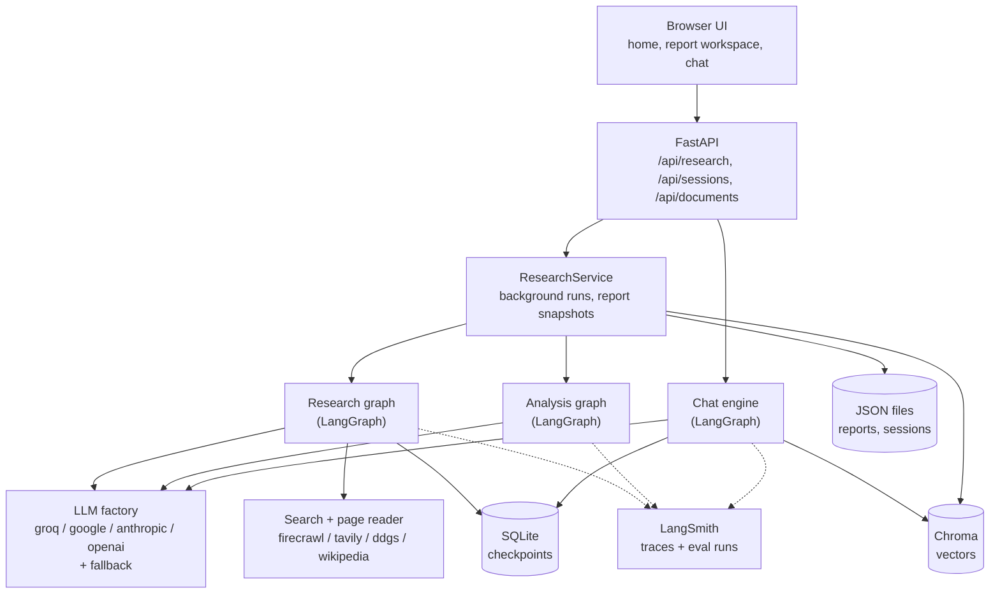
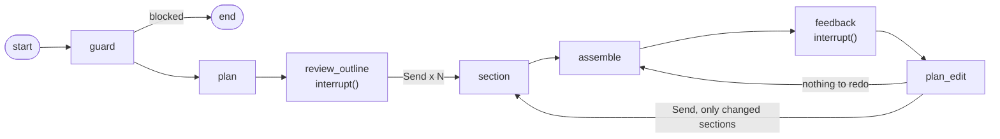
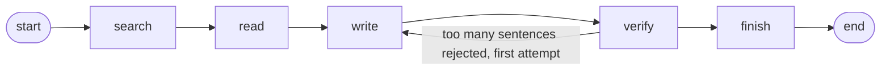
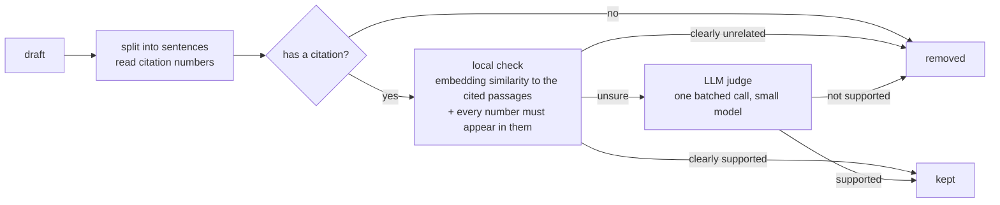
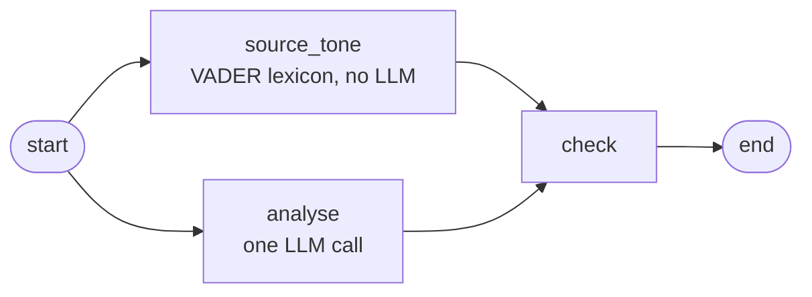

# ResearchPilot architecture

## 1. The system in one picture



Three graphs, one per job. They share the LLM factory, the embedder and the vector store, and nothing else.

## 2. Research graph

File: `app/research/graph.py`



| Node | What it does |
|---|---|
| `guard` | Masks personal data in the topic, blocks prompt injection and unsafe requests before any LLM call. |
| `plan` | One LLM call. Returns sections, each with questions to answer and search queries. |
| `review_outline` | Calls `interrupt()`. The run stops here until the user approves or edits the outline. |
| `section` | Runs the section worker (below) for one section. Fan-out uses LangGraph `Send`, so sections run in parallel. |
| `assemble` | Records what changed in this pass (used for the History tab) and clears the work list. |
| `feedback` | Calls `interrupt()` again. The report is "ready" while the graph waits here. |
| `plan_edit` | Turns a change request into operations: expand, rewrite, replace sources, add, remove. |

The graph never ends on its own. A report is one long-lived thread (`thread_id = research-<id>`) that alternates between
working and waiting for a human. That is what the checkpointer is for.

### Section worker

File: `app/research/section.py`



| Step | Detail |
|---|---|
| `search` | Runs the planned queries. On "expand" it keeps the old sources and adds a query. On "replace sources" it drops the weaker half of the old sources. |
| `read` | Fetches pages in parallel, extracts text with trafilatura, splits it into passages, embeds them and keeps the passages closest to the section's questions (at most 3 per source). |
| `write` | The model sees only the numbered passages and must end every sentence with the source number. |
| `verify` | Splits the draft into sentences and checks each against the source it cites. |
| `finish` | Drops sentences that failed, computes the trust score, bumps the version. |

It is a separate compiled graph so that a change request can run it for one section without touching the others.

### State

```python
class ResearchState(TypedDict, total=False):
    report_id: str
    topic: str
    blocked: str                                    # reason, when the guard refuses the topic
    outline: list[dict]                             # ordered: id, title, questions, queries
    sections: Annotated[dict[str, dict], merge]     # section id -> section (written by parallel workers)
    sources: Annotated[dict[str, dict], merge]      # source id -> source registry
    todo: list[str]                                 # section ids to (re)do in this pass
    edits: dict[str, dict]                          # section id -> {mode, instruction}
    feedback: dict                                  # the last change request
    history: Annotated[list[dict], add]             # one entry per pass: what changed, before and after
```

Design choices:

- **Sections are a dict keyed by id, not a list.** Parallel workers each return `{id: section}` and the `merge` reducer
  combines them. A revision returns only the changed ids, so untouched sections are literally the same objects.
- **`todo` is the unit of work.** The dispatcher sends one worker per id in `todo`. The first run puts every id in it.
  A revision puts in one or two. This is the whole "update only the affected sections" mechanism.
- **Source ids are a hash of the URL** (`s` + 8 hex chars), assigned when the page is fetched. They stay attached to every
  passage and every sentence from that point on. Citation numbers `[1]`, `[2]` are only computed when rendering.
- **Everything in state is plain JSON.** No custom classes, so the checkpointer can save and restore it without special
  handling, and the report file on disk is the same shape.

### Human in the loop

| Where | Mechanism | What the user can do |
|---|---|---|
| Outline | `interrupt()` in `review_outline` | Approve, rename, reorder, add or remove sections before anything is researched |
| After the report | `interrupt()` in `feedback` | Free-text request, or per-section buttons: More detail, Better sources, Rewrite, Remove |
| Chat tools | `interrupt()` in the chat engine's `approval` node | Approve or reject a document deletion |

Section buttons already say which section and what to do, so `plan_edit` skips its LLM call for them.

Because state is checkpointed to SQLite after every step, a run survives a server restart. The UI shows "Paused" with a
"Resume from checkpoint" button, which calls `graph.stream(None, config)`.

## 3. How a claim is verified

File: `app/research/verify.py`



Rule: **no citation, no claim.** A sentence stays only if it cites a source and that source backs it.
The local check costs milliseconds and settles most sentences; the LLM judge only sees the unsure ones, in one call.
If more than 40% of a draft is rejected, the writer gets one more attempt with the rejected sentences listed.

A URL can only be cited if the page was actually downloaded in this run, because source ids are created by the fetcher.
The model never writes URLs. This is why fabricated references cannot happen.

Each kept sentence stores the passage that best supports it and the match score. The UI shows it when you click a citation.

## 4. Analysis agent

File: `app/research/analysis.py`



**Why a separate graph and not more nodes in the research graph:**

1. It only reads a finished report. Keeping it out of the research graph means a failed analysis can never damage a report.
2. It has a different trigger. Research runs once per section change; analysis runs when the user asks, and again after edits.
3. It has no human step, so it does not need a checkpointer or a thread.

Output: overall sentiment, sentiment per section (label, score, one-line reason), sentiment per source, and
takeaways, opportunities, risks and next steps. The `check` node removes any recommendation that does not point at a real
section, so every item is traceable. It also compares the LLM's section label with the lexicon score and flags
disagreements in the UI as "models disagree".

## 5. Knowledge base and chatbot

- `app/research/kb.py` stores each section as its own document (`report-<id>-<section>`), chunked with the configured
  chunker. Every chunk carries `report_id`, `section`, `section_id`, the cited `urls` and a `content_hash`.
- On re-sync only sections whose hash changed are embedded again. After a revision that touches one section, one section
  is re-embedded.
- A chat session created from a report stores `report_id`. The chat engine passes it to the retriever as a metadata
  filter, so answers come from that report only.
- Retrieval is dense, BM25 or hybrid (reciprocal rank fusion), chosen by `RETRIEVAL_MODE`.
- "I don't know": chunks below `MIN_SCORE` are discarded. If nothing is left the engine answers
  "I couldn't find that in the documents" without calling the LLM. A grounding check after generation replaces
  answers that the retrieved text does not support.
- Follow-ups: the router detects them and a `rewrite_query` node turns "explain that more simply" into a standalone
  search query using the conversation.

## 6. Guardrails

| Layer | Guardrail | Where |
|---|---|---|
| Input | Length, control characters, prompt injection and unsafe request patterns | `app/chat/guardrails.py`, used by chat and research |
| Input | Personal data and secrets masked before they reach the LLM, traces or disk | `app/chat/pii.py` |
| Web | Only public http(s) URLs. Localhost, private ranges and link-local addresses are refused, also after redirects | `app/research/reader.py` |
| Web | 2 MB download cap, 5 s timeout, HTML only | `app/research/reader.py` |
| Web | Web text is treated as data: instruction-like lines are neutralised and the prompt says to ignore instructions in sources | `sanitize_chunk`, `WRITE_PROMPT` |
| Output | Every sentence needs a citation and must pass verification | `app/research/verify.py` |
| Output | Citations can only point at pages fetched in this run | `app/research/section.py` |
| Output | Recommendations must reference existing sections | `app/research/analysis.py` |
| Output | Chat answers are checked against retrieved text | `verify` node in `app/chat/engine.py` |
| Cost | Hard cap on LLM calls per run, at most 2 runs at once, one rewrite attempt per section | `usage.py`, `api/research.py`, `section.py` |
| Reliability | Provider fallback, search fallback, retries on rate limits | `chat/llm.py`, `research/search.py` |
| Human | Outline approval, change requests, tool approval | see section 2 |

## 7. Swapping providers

- **LLM:** `build_model(provider, model)` in `app/chat/llm.py` is the only place that imports provider packages.
  `get_llm()` wraps the main model with the fallback using LangChain's `with_fallbacks`.
- **Search:** `make_search(provider)` returns a plain function `(query, limit) -> results`. New providers are one
  function and one dictionary entry.
- **Embeddings:** `EMBEDDING_MODEL` picks the backend. The Chroma collection name includes the model name, so changing
  the model never mixes vectors of different sizes.
- **Tests** pass fakes for all of these through `Deps`, so the research graph is tested without network access.

## 8. Observability

- LangSmith traces every graph run. Research runs carry `report_id` in metadata, chat runs carry `session_id`.
- Each node is wrapped with `traced_node`, which records latency per step.
- `UsageTracker` (a LangChain callback) counts LLM calls and tokens per run and estimates cost. The UI shows this in the
  Runs tab together with search calls and pages read.
- Eval runs are tagged `eval` plus the version label, so two versions can be compared in LangSmith as well.

## 8a. Accounts

- `app/auth/` holds the rules (`service.py`), the pages and endpoints (`router.py`), the SQLite store (`store.py`)
  and the Brevo mailer (`email.py`).
- Sign-up creates an unverified user and e-mails a 6-digit code (15 minutes). Sign-in checks a bcrypt hash and sets
  an http-only cookie. "Forgot" e-mails a one-time link (30 minutes). Ten wrong attempts lock the address for 15 minutes.
- Login sessions, codes, reset tokens and rate-limit counters live in one key-value table with expiry times, so a
  restart logs nobody out.
- A middleware in `app/main.py` lets visitors reach only `/`, `/welcome`, `/auth` and static files.
- Chats and reports store the id of the user who made them. `UserSessions` in `app/deps.py` and `get_service` in
  `app/api/research.py` hide everything that belongs to someone else.

## 9. What we added beyond the brief

| Extra | Why it matters | Latency cost |
|---|---|---|
| Click a citation to see the supporting passage and match score | The reader can check any sentence in two seconds | none, the data already exists |
| Two-stage verification | Removes unsupported sentences without an LLM call per sentence | one small batched call per section |
| Trust score per section and report | A quick signal of where to look harder | none |
| Section buttons that skip the planning call | Common edits start instantly | saves one call |
| Version history with word-level diff | Shows exactly what a revision changed and that other sections were untouched | none |
| Evidence cache for searches and pages | Edits and eval reruns do not hit the same site twice; makes the v1 vs v2 comparison fair | saves time |
| Incremental knowledge base sync | Only changed sections are re-embedded | saves time |
| Lexicon second opinion on sentiment | Flags sections where the LLM's reading may be wrong | milliseconds |
| Provider fallback and a separate small model | Keeps working when one provider is down; spreads load across rate limits | none |
| Resume from checkpoint after a crash | No lost work | none |
| Suggested chat questions from the outline | The planner already wrote them | none |
| Markdown export and print layout | Stretch goal from the brief | none |

## 10. Known limits

- With `SEARCH_PROVIDER=ddgs` the free endpoint blocks bursts, so searches run one at a time. `firecrawl` and `tavily` run in parallel.
- Verification is similarity plus an LLM judge. It catches unsupported sentences well but it can still pass a subtle
  misreading of a source. The evals measure how often.
- Progress events live in memory. After a restart the report is intact but the activity log starts empty.
- `score_source` in `app/research/trust.py` decides how much a domain is trusted. It is a simple rule, not a reputation service.
- Postgres, Redis, MinIO and Brevo keys from the shared `.env` are not used by this codebase.
